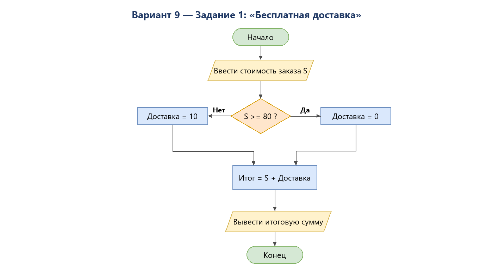

# Лабораторная работа №1 — Вариант 9

| Файл | Задание |
| --- | --- |
| [`docs/task1_flowchart.drawio`](docs/task1_flowchart.drawio) | 1 — блок-схема «Бесплатная доставка» |
| [`docs/task1_flowchart.png`](docs/task1_flowchart.png) | та же схема в виде картинки |
| [`task2_bonus.cpp`](task2_bonus.cpp) | 2 — премия к зарплате |
| [`task3_delivery.cpp`](task3_delivery.cpp) | 3 — стоимость доставки |

## Задание 1. Бесплатная доставка

Схема в draw.io: `docs/task1_flowchart.drawio` (открывать на https://app.diagrams.net/).

Правило: доставка стоит 10, но при стоимости заказа `S >= 80` она бесплатна.



**Входные данные:** стоимость заказа `S` (вещественное число, `S >= 0`).
**Результат:** общая сумма к оплате `Итог = S + Доставка`.

**Алгоритм словами:**
1. Получить стоимость заказа `S`.
2. Если `S >= 80`, доставка бесплатна (`Доставка = 0`).
3. Иначе доставка стоит 10 (`Доставка = 10`).
4. Вычислить итог: `Итог = S + Доставка`.
5. Вывести итоговую сумму.

**Используемые структуры:** последовательность с ветвлением (ромб `S >= 80 ?`).

**Проверка схемы:**
- `S = 50` → `50 < 80` → доставка 10 → итог **60.00**;
- `S = 80` → `80 >= 80` → доставка 0 → итог **80.00**;
- `S = 120` → `120 >= 80` → доставка 0 → итог **120.00**.

## Задание 2. Премия к зарплате

Считать зарплату и процент премии. Вывести сумму премии и итоговую зарплату.

`Премия = Зарплата * Процент / 100`, `Итог = Зарплата + Премия`.
Отрицательные зарплата и процент считаются ошибкой.

**Пример:** зарплата 50000, премия 10 % → премия 5000.00, итог 55000.00.

## Задание 3. Стоимость доставки

Считать стоимость заказа и массу. Доставка стоит 10; при массе больше 10 добавляется 8;
но при стоимости заказа от 100 доставка бесплатна. Вывести стоимость доставки и итог.

Правило:
- если `Стоимость >= 100` → доставка 0 (бесплатно);
- иначе доставка 10, и если `Масса > 10`, добавляется 8 (итого 18).

**Примеры:**
- стоимость 120, масса 15 → доставка 0.00, итог 120.00;
- стоимость 50, масса 15 → доставка 18.00, итог 68.00;
- стоимость 50, масса 5 → доставка 10.00, итог 60.00.

## Сборка и запуск

Компилятор MSVC (Developer Command Prompt):

```bat
cl /EHsc /std:c++17 task2_bonus.cpp
cl /EHsc /std:c++17 task3_delivery.cpp
```

Или g++/MinGW:

```bat
g++ -std=c++17 -O2 task2_bonus.cpp -o task2_bonus.exe
g++ -std=c++17 -O2 task3_delivery.cpp -o task3_delivery.exe
```

---

Автор: ФИО студента
